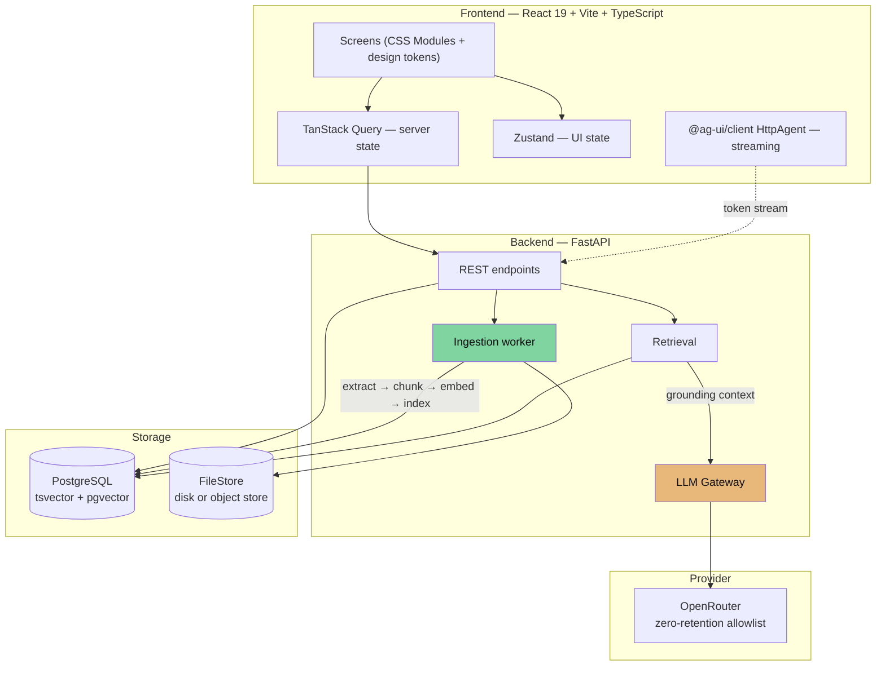
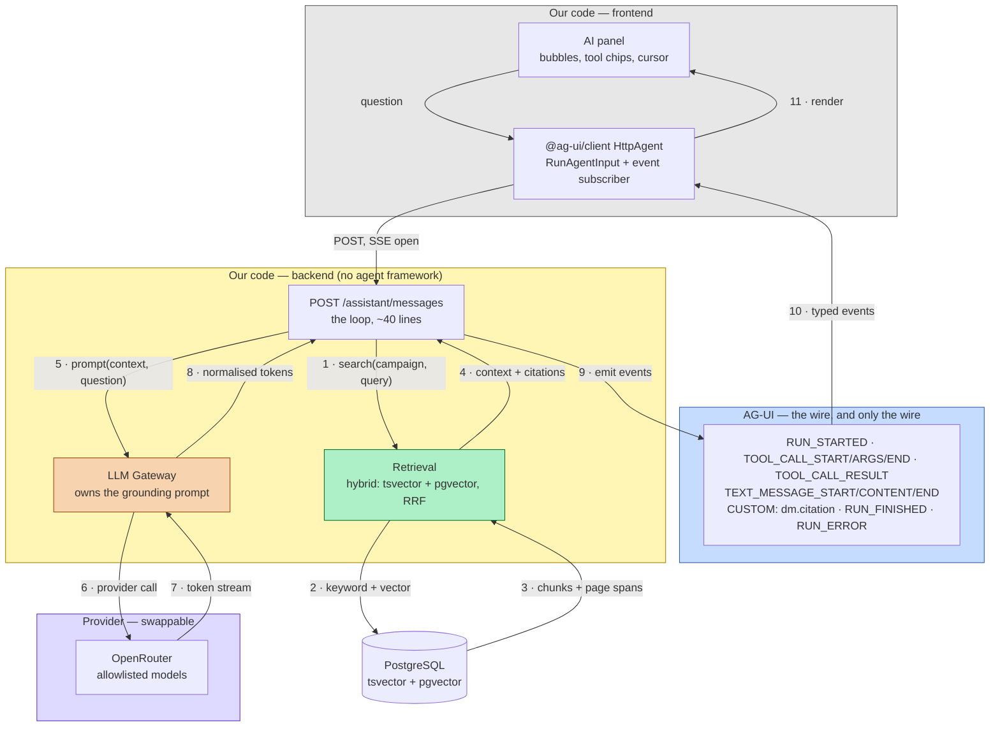

# Architecture

The same diagrams are on a Miro board — **[open the architecture board](https://miro.com/app/board/uXjVHrcVIJQ=/)** — which is
easier to walk someone through than a page of Mermaid. This file stays the source of
truth; the board mirrors it.

## Shape



The green path is deterministic and never calls a model. The amber path is the only
place a model is invoked.

## Stack

| Layer | Choice | Rationale |
|-------|--------|-----------|
| Frontend framework | React 19 + TypeScript (strict) | [ADR-0001](adr/adr-0001-react-vite-spa.md) |
| Build / dev server | Vite | Same ADR — SPA with no SSR need |
| Routing | React Router v7 | Client routing matches the design's screen model |
| Server state | TanStack Query | Caching, polling for document status, invalidation |
| UI state | Zustand | Rail expansion, panel open, sheets, filters |
| Component primitives | Radix UI | Unstyled and accessible; the design is fully custom |
| Styling | CSS Modules + CSS custom properties | [ADR-0004](adr/adr-0004-css-modules-over-tailwind.md) |
| Component docs | Storybook | Primitives are documented as they are built |
| Backend | Python 3.11+ / FastAPI | [ADR-0001](adr/adr-0001-react-vite-spa.md) |
| Storage | PostgreSQL (`tsvector` + `pgvector`); hosted in v1, local in v2 | [ADR-0018](adr/adr-0018-hosted-first-local-v2.md) |
| Retrieval | Hybrid keyword + vector, RRF-fused | [ADR-0021](adr/adr-0021-gemini-embeddings-via-openrouter.md) |
| Embeddings | Gemini Embedding 2 via OpenRouter (zero-retention Vertex EU), 1024 dims — one fixed model, not switchable | [ADR-0021](adr/adr-0021-gemini-embeddings-via-openrouter.md) |
| Import sources | Upload; Google Drive via Picker (`drive.file`) | [ADR-0017](adr/adr-0017-import-sources.md) |
| Extraction | PyMuPDF for PDFs; Tesseract (`eng+pol`) for scanned pages; stdlib for Markdown, text, DOCX | Deterministic; [ADR-0002](adr/adr-0002-deterministic-extraction.md) IMP-005 |
| LLM access | Gateway over OpenRouter (zero-retention allowlist) | [ADR-0019](adr/adr-0019-openrouter-privacy-routing.md) |
| Assistant streaming | AG-UI protocol over SSE | [ADR-0009](adr/adr-0009-ag-ui-protocol.md) |
| Agent loop | Plain FastAPI — no framework, bounded tool loop | [ADR-0011](adr/adr-0011-assistant-tools.md) |
| Assistant | One profile: cited facts, marked ideas · In character | [ADR-0026](adr/adr-0026-one-assistant-claim-provenance.md), [ADR-0012](adr/adr-0012-two-ai-modes.md) |
| Testing | Vitest + Testing Library, Playwright, pytest | |

## Repository layout

A plain workspace, not an Nx monorepo — two apps and a small shared library do not need
a build orchestrator. [folder-structure.md](folder-structure.md) is authoritative for
both trees; this is the outline.

```
dm_assistant/
├── docs/                     # this documentation
├── frontend/
│   ├── src/
│   │   ├── app/              # router, providers, shell
│   │   ├── screens/          # login, campaigns, workspace views
│   │   ├── features/         # documents, characters, factions, quests,
│   │   │                     #   sessions, graph, assistant
│   │   ├── ui/               # Radix wrappers + design-token primitives
│   │   ├── styles/           # tokens.css, reset, global
│   │   └── lib/              # api client, hooks, utils
│   └── vite.config.ts
├── backend/                  # hexagonal: ports and adapters
│   ├── app/
│   │   ├── domain/           # entities and values, stdlib only
│   │   ├── ports/            # protocols: repositories, llm, search, files, clock
│   │   ├── application/      # use cases: assistant turn, upload, ingest, retrieval
│   │   ├── adapters/
│   │   │   ├── persistence/  # sqlalchemy (PostgreSQL, migrations, hybrid chunk search) + memory
│   │   │   ├── llm/          # the Gateway: openrouter, fake, prompts
│   │   │   ├── extraction/   # PyMuPDF, OCR (no LLM)
│   │   │   └── files/        # FileStore: local disk, object store
│   │   ├── entrypoints/      # http routers, worker, cli
│   │   └── composition.py    # the only module wiring ports to adapters
│   └── pyproject.toml
├── compose.yaml              # db, backend, frontend for local use
└── README.md
```

## Ingestion pipeline

Deterministic end to end. No model is called at any step.

```mermaid
sequenceDiagram
    participant U as GM
    participant API as FastAPI
    participant W as Worker
    participant DB as PostgreSQL

    U->>API: POST /documents (file)
    API->>API: sha256 — already indexed? return existing
    API->>DB: insert document (status=queued, progress=0)
    API-->>U: 202 + document id
    Note over U,API: UI polls status — upload never blocks

    W->>DB: claim queued document
    W->>DB: status=processing
    W->>W: extract text per page (PyMuPDF; headings by font size)
    W->>W: near-zero characters? → OCR the page (Tesseract)
    W->>W: OCR confidence below the floor? → page left out, counted as unreadable
    W->>W: drop repeated headers, footers, watermarks
    W->>W: split on paragraph + heading boundaries, ~1,800 chars, ~200 overlap
    W->>W: embed each chunk (Gemini via OpenRouter, one text per request)
    W->>DB: insert chunks + tsvector + embedding
    W->>DB: status=indexed, progress=100
```

Failure sets `status=failed` and records `error`. Progress is written per processed page
so the design's percentage bar reflects real work: reading pages fills 0–50%, embedding
50–99%. If the embedder is down the document goes back to `queued` and the worker backs
off (30 s doubling to 15 min); a provider outage never marks a document `failed`. If
Tesseract is not installed, a scanned PDF waits in `awaiting_ocr`.

The worker is a thread inside the API process (`entrypoints/worker/`), started by the
app's lifespan. Claims use `FOR UPDATE SKIP LOCKED`, so two workers never take the same
document, but start-up requeues every `processing` document, which is only safe with one
process. Before running more than one replica, move the worker to its own process with a
claim lease.

Embedding is part of this deterministic path: it derives a vector from the document's own
text and invents nothing. BND-001 bars a **generative** model from ingestion, not every
model ([ADR-0021](adr/adr-0021-gemini-embeddings-via-openrouter.md) IMP-008).

## Retrieval and grounding

```mermaid
sequenceDiagram
    participant U as GM
    participant API as FastAPI
    participant R as Retrieval
    participant DB as PostgreSQL
    participant GW as Gateway

    U->>API: POST /assistant/messages
    API-->>U: AG-UI: RUN_STARTED
    API->>R: search(campaign, system, query)
    API-->>U: AG-UI: TOOL_CALL_START
    R->>R: embed the query (Gemini, keyword-only if unavailable)
    R->>DB: tsvector match + pgvector ANN, one query
    DB-->>R: two ranked lists
    R->>R: fuse (RRF), apply relevance floor
    R-->>API: context + citations, or nothing above the floor
    API-->>U: AG-UI: TOOL_CALL_RESULT
    API->>GW: prompt(style guide, context, question)
    GW-->>API: token stream, or a propose_memory call
    API-->>U: AG-UI: TEXT_MESSAGE_CONTENT (delta, repeated)
    API-->>U: AG-UI: TOOL_CALL_START/ARGS/END propose_memory (a draft; nothing written)
    API-->>U: AG-UI: CUSTOM dm.citation
    API-->>U: AG-UI: RUN_FINISHED
```

Every arrow back to the GM is an **AG-UI event**; everything between API, Retrieval, and
Gateway is our own code. The protocol governs the wire, not the logic
([ADR-0009](adr/adr-0009-ag-ui-protocol.md), [ADR-0010](adr/adr-0010-no-agent-framework.md)).

**The grounding rule.** The prompt instructs the model to cite every factual statement
from the supplied context, to state plainly when the context does not answer a factual
question, and to leave its own ideas uncited (PRIN-001, AC-003). Retrieved chunk ids are
returned with the response and stored as citations, so every factual claim is traceable
to a source; the panel marks each paragraph without a valid citation as an idea
([ADR-0026](adr/adr-0026-one-assistant-claim-provenance.md)).

GM-private `notes` are excluded from retrieval context by default (DEC-004).

## One request, end to end

What actually happens when a GM types a question. **Only the middle band is AG-UI** — the
protocol owns the events on the wire and nothing else. Retrieval, the prompt, the provider
call, and the loop are all our own code ([ADR-0010](adr/adr-0010-no-agent-framework.md)).



### The tools

The loop is bounded and the tool set is small ([ADR-0011](adr/adr-0011-assistant-tools.md)):

| Tool | Purpose | Writes |
|------|---------|--------|
| `search_documents` | Hybrid search over indexed chunks | — |
| `get_session`, `list_sessions` | Session records, for summaries | — |
| `get_character`, `get_faction` | Campaign entities | — |
| `propose_character`, `propose_faction` | A draft plus per-field sources | **Draft only** |
| `propose_memory` | A campaign note or a style-guide addition ([ADR-0026](adr/adr-0026-one-assistant-claim-provenance.md)) | **Draft only** |

**No tool writes.** A proposal returns a populated form with the chunk ids each field came
from; the GM edits and submits through the normal `POST /characters`. The model suggests,
the GM commits — which is what keeps this downstream of
[ADR-0002](adr/adr-0002-deterministic-extraction.md) rather than in violation of it. A
saved campaign note is submitted through the normal document upload as `notes/<slug>.md`;
a style addition through `PATCH /settings`.

### What owns what

| Layer | Owns | Does **not** own |
|-------|------|------------------|
| **AG-UI** | The event names and shapes crossing the wire | Retrieval, prompting, the loop, provider access |
| **Our endpoint** | The loop: retrieve → prompt → stream → emit | How search works; how providers differ |
| **Gateway** | Provider access **and the grounding prompt** | What gets retrieved |
| **Retrieval** | Chunk selection and ranking | Anything a model touches |

**There is no agent framework in this picture, deliberately.** LangChain, LangGraph, and
Pydantic AI would each take over the loop in step 5 — and with it the prompt assembly,
which is the one place PRIN-001's grounding rule is enforced. With one assistant and one
tool, that loop is a few dozen readable lines. See
[ADR-0010](adr/adr-0010-no-agent-framework.md).

**Where a framework would slot in**, if it ever earns its place: between the endpoint and
the Gateway, owning steps 5 through 8. The Gateway boundary is what keeps that swap
possible without touching the frontend, since AG-UI events would still be what reaches the
wire.

**There is no router.** Every message goes through one profile; there is no classifier
hop before the model ([ADR-0026](adr/adr-0026-one-assistant-claim-provenance.md)).

## Frontend state

Three distinct concerns, deliberately not merged:

- **Server state** — TanStack Query. Campaigns, entities, documents, messages. Document
  status polls while any document is `queued` or `processing`, then stops.
- **UI state** — Zustand. `navHover`, `navPinned`, `panelOpen`, `moreOpen`, `mob`,
  filters, composer visibility. Ephemeral, never persisted.
- **Streaming** — one `@ag-ui/client` `HttpAgent` per send (not `EventSource`: the send is
  a POST with a bearer token). Its subscriber appends text deltas to the reply being
  rendered, and the panel aborts the run on close and on "New conversation". When the run
  ends, the stored history is refetched and replaces the live reply.

The prototype holds all of this in one class component. That is correct for a prototype
and wrong for the app: server data and UI chrome have different lifetimes.

## Boundaries that matter

**BND-001 — No generative model in the ingestion path.** Enforced structurally:
the ingestion use cases and `adapters/extraction/` have no import path to `adapters/llm/`
(the Gateway). A test asserts this. The embedding model is
not in scope: it derives vectors from the document's own text and writes no content
([ADR-0021](adr/adr-0021-gemini-embeddings-via-openrouter.md) IMP-008).

**BND-002 — All model calls go through the Gateway.** No provider SDK is imported outside
`adapters/llm/`. Provider switching is configuration, not code.

**BND-003 — Campaign scoping is enforced server-side.** Every query filters by
`campaign_id`. The frontend never sees another campaign's data. The one shared read scope
is the system rules library in Arkon, reached only through retrieval with the campaign's
system's read-only token ([ADR-0027](adr/adr-0027-arkon-shared-library.md)).

**BND-006 — No agent framework owns the loop.** The tool loop is plain code in
`application/assistant/run_turn.py`, bounded to a fixed number of iterations. A framework there would also
own prompt assembly, moving the grounding rule out of the single place that enforces it
([ADR-0011](adr/adr-0011-assistant-tools.md)).

**BND-008 — One profile per surface, uncited text shown as an idea, unsaved output never
indexed.** Quillbert and in-character each have one prompt strategy, built in exactly one
place. Every paragraph without a valid citation is marked as an idea
([ADR-0026](adr/adr-0026-one-assistant-claim-provenance.md)). Assistant and in-character
output is **never indexed** unless the GM saves it as a note — otherwise invention
becomes retrievable as fact, defeating
[ADR-0002](adr/adr-0002-deterministic-extraction.md) from the other direction.

**BND-007 — No tool writes to the campaign.** `propose_*` tools return drafts; the GM
confirms through the ordinary create endpoints. A test asserts no proposal tool is
reachable from the ingestion path, keeping [ADR-0002](adr/adr-0002-deterministic-extraction.md)
structural rather than conventional.

**BND-005 — Provider streams are normalised inside the Gateway.** Model-provider event
shapes never reach the wire; the Gateway converts them to AG-UI events, so switching
providers cannot change what the frontend sees
([ADR-0009](adr/adr-0009-ag-ui-protocol.md)).

**BND-004 — The design prototype is never imported.** `Referee Workspace.dc.html` and
`support.js` are references. Values are transcribed into tokens; markup is rebuilt.
