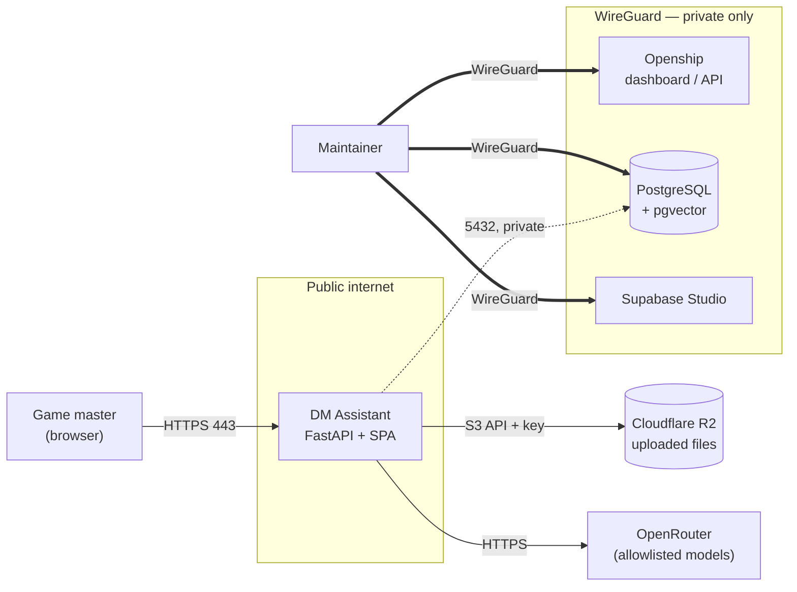

# Deployment

How v1 runs in production. v1 is **hosted-first** ([ADR-0018](adr/adr-0018-hosted-first-local-v2.md));
running the full stack on a game master's own machine is a v2 goal, not a v1 target.

Which host, which Postgres image, and which object store sit behind the architecture is a
**deployment choice, not an ADR**. The decision records fix the *ports* — PostgreSQL as the
single store ([ADR-0013](adr/adr-0013-postgres-for-local-and-hosted.md)) and a `FileStore`
object store ([ADR-0013](adr/adr-0013-postgres-for-local-and-hosted.md) IMP-005,
[ADR-0017](adr/adr-0017-import-sources.md)) — and this file records the concrete providers
chosen for them. Swapping any provider is a change *here*, not to a decision record.

## Topology

| Layer | Choice | Why |
|-------|--------|-----|
| Orchestration | **Openship** (self-hosted, Apache-2.0) | One dashboard, secrets, domains, and deploys across several apps — the maintainer runs more than this one |
| Servers | **Mikrus** VPS — a control-plane box and a workload box | Cheap, Docker-capable, WireGuard built in; attach a sturdier box later without re-platforming |
| Private network | **WireGuard** | Admin surfaces and the database are reachable only over the VPN; the public internet sees the app and nothing else |
| Database | **PostgreSQL + `pgvector`** (Supabase app, or a `pgvector` image) | The single store the schema and hybrid retrieval require |
| Files | **Cloudflare R2** (S3-compatible) | Zero egress, effectively free at this scale, and off-box so files survive a server rebuild |
| Mail | **Openship** built-in transactional mail | Password-reset delivery ([ADR-0008](adr/adr-0008-own-auth-v1.md)), SPF/DKIM/DMARC auto-configured |
| LLM | **OpenRouter**, zero-retention allowlist | [ADR-0019](adr/adr-0019-openrouter-privacy-routing.md) — not hosted here; a managed API reached with a key |

## Components

### Orchestration — Openship

Openship runs self-hosted and free. Its **control plane** (its own dashboard, API, Postgres,
and Redis) lives on a small long-lived box; **workloads** are deployed onto one or more
connected servers. Adding an app or a server is a dashboard action, which is the reason to
run this layer at all rather than a bare `docker compose` — the maintainer hosts more than
this project. The control-plane state is itself critical and is backed up (see
[Backups](#backups)).

### Servers — Mikrus

Two VPS instances to start:

- **Control plane** — ~2 GB RAM (e.g. Mikrus 3.0). Small, stable, rarely touched.
- **Workload** — ~16 GB RAM (e.g. Mikrus 4.2). Runs the DM Assistant's Postgres, FastAPI
  API, and the ingestion worker, with headroom for the next app.

Mikrus is best-effort hobby hosting: oversubscribed, no SLA, vCPU not advertised. That is
acceptable for a single-user tool. Because Openship manages heterogeneous servers, an app
that outgrows it can be moved to a sturdier box (e.g. Hetzner) under the **same** dashboard —
there is no lock-in to Mikrus. Docker is required, so Mikrus 2.1+ only (1.0 ships without it).

### Network — WireGuard

The security boundary. **Public: only the app's HTTPS routes.** Everything else is bound to
the WireGuard interface and never exposed to the internet:

- the Openship dashboard and API,
- PostgreSQL (`5432`),
- Supabase Studio and any other admin UI.

The database is never published; the app reaches it over the private interface, and the
maintainer reaches admin surfaces over the VPN. (WireGuard is included on Mikrus 2.1+ and
doubles as a personal VPN.)

### Database — PostgreSQL + pgvector

PostgreSQL is the single store ([ADR-0013](adr/adr-0013-postgres-for-local-and-hosted.md)),
and hybrid retrieval needs the **`pgvector`** extension
([ADR-0016](adr/adr-0016-voyage-embeddings.md), [ADR-0014](adr/adr-0014-hybrid-retrieval.md)).
Two ways to get it on the workload box:

- **Supabase app** — its Postgres ships `pgvector`; heaviest but zero-doubt. If used,
  **only its Postgres and Storage are in scope. Authentication stays hand-built**
  ([ADR-0008](adr/adr-0008-own-auth-v1.md)) — Supabase Auth (GoTrue) is not used, and turning
  it on would be a conscious supersession of ADR-0008, not a default.
- **`pgvector/pgvector` image** — leaner; run it directly if the full Supabase stack is not
  wanted.

Either way, confirm `CREATE EXTENSION vector` succeeds before relying on ingestion.

### Files — Cloudflare R2

R2 is the hosted `FileStore` object-store adapter: S3-compatible, so the adapter is an
ordinary S3 SDK (boto3) pointed at the R2 endpoint. Free tier is 10 GB storage, 1M writes,
10M reads per month, with **zero egress** — a single-user campaign stays comfortably inside
it. Files are served to the browser with **presigned URLs** (the browser fetches straight
from R2, so the backend never proxies bytes and egress stays free). Keeping files on R2,
off the VPS, means they survive a server rebuild or move.

### Secrets

All configuration is environment variables supplied through **Openship secrets** — never
committed. At minimum:

| Variable | Purpose |
|----------|---------|
| `DATABASE_URL` | PostgreSQL connection (private interface) |
| `R2_ACCESS_KEY_ID`, `R2_SECRET_ACCESS_KEY`, `R2_BUCKET`, `R2_ENDPOINT` | Cloudflare R2 |
| `OPEN_ROUTER_API_KEY` | LLM gateway ([ADR-0019](adr/adr-0019-openrouter-privacy-routing.md)); in CI, a GitHub **secret**, not a variable |
| JWT signing secret | Session cookies ([ADR-0008](adr/adr-0008-own-auth-v1.md)) |
| Mail/SMTP settings | Password-reset delivery |

## Backups

A budget host and a young orchestrator make the restore path the safety net. Schedule:

- **PostgreSQL** — regular `pg_dump` to off-box storage (Openship supports scheduled external
  backups). Migrations are versioned ([ADR-0013](adr/adr-0013-postgres-for-local-and-hosted.md) IMP-002),
  so a restore replays cleanly.
- **Openship control-plane state** — it is the orchestration brain; back it up too.
- **Files** — covered by R2 itself; enable bucket versioning for accidental-delete recovery.

## Before relying on it

- [ ] `pgvector` extension enabled and a vector query works on the workload box.
- [ ] A 400-page PDF reaches `Indexed` in acceptable time — Mikrus CPU is the real unknown
      (AC-001); load-test before trusting it.
- [ ] Postgres, Studio, and the Openship dashboard are reachable **only** over WireGuard;
      only the app's HTTPS port is public.
- [ ] Scheduled backups configured for the database and the control-plane state; R2
      versioning on.
- [ ] All secrets set in Openship, none in the repository.

## Cost (approximate)

At ~3.65 zł/$; Mikrus is billed per year.

| Item | Plan | Approx |
|------|------|--------|
| Openship | self-hosted software | free |
| Control-plane VPS | Mikrus 3.0 (2 GB) | 130 zł/yr (~$3/mo) |
| Workload VPS | Mikrus 4.2 (16 GB) | 790 zł/yr (~$18/mo) |
| Files | Cloudflare R2 | ~$0 (free tier, zero egress) |
| LLM | OpenRouter | usage-based |
| **Infra total** | | **~920 zł/yr (~$21/mo)** + LLM usage |

## References

- [ADR-0018](adr/adr-0018-hosted-first-local-v2.md) — hosted-first MVP, local deferred to v2
- [ADR-0013](adr/adr-0013-postgres-for-local-and-hosted.md) — PostgreSQL store and the `FileStore` port
- [ADR-0017](adr/adr-0017-import-sources.md) — storage chosen per deployment
- [ADR-0019](adr/adr-0019-openrouter-privacy-routing.md) — OpenRouter provider and the API key
- [ADR-0008](adr/adr-0008-own-auth-v1.md) — authentication built by hand; not delegated
