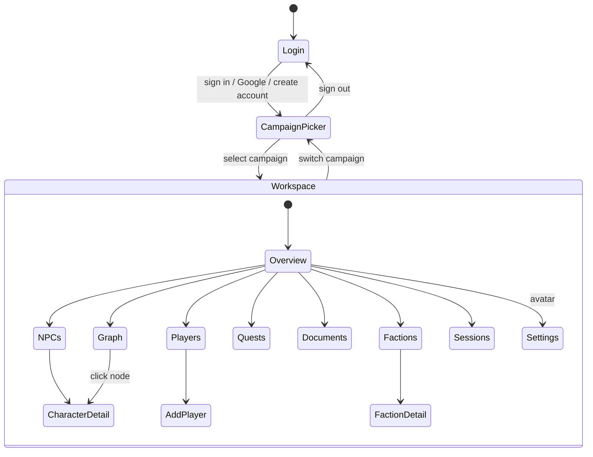

# Design

Screens, layout, and behaviour. Exact values live in [reference.md](reference.md).

## The prototype

**▶ [Open the interactive design](https://claude.ai/artifact/Mj2PbfYr7chU4rxyJtrZMh)**

This is the source of truth. It is the running prototype, not a picture of one — click
through the login and campaign picker into the workspace, switch views from the nav rail,
hover a graph node, toggle the assistant panel, and resize below 900px to see the mobile
shell.

Prefer it over any screenshot. A screenshot captures one frame of one state and goes stale
silently; the prototype shows current behaviour, and interaction is most of what this
design specifies.

Two things to know about the link:

- It is **pinned to a published version**. Republishing the design does not change what
  this link shows until the share pin is moved — deliberate, so the documented design
  cannot shift underfoot mid-implementation.
- Fidelity is **high**. Colors, type, spacing, and interaction states are final as shown.

**Do not port the prototype's code.** It is a `.dc.html` reference with an inline runtime;
read it for structure, layout, and exact values only, and rebuild with the project's own
primitives (BND-004). Its values are transcribed into [reference.md](reference.md), which
is what implementation should follow.

Source project: Claude Design `ec1d38ec-c81f-42b8-8952-7a922851f405`, file
`Referee Workspace.dc.html`.

## Screen model

Two levels of routing. A top-level `screen`, and within the workspace, a `view`.

Routes map to URLs: `/login`, `/campaigns`, `/c/:campaignId/:view`.

## 1. Login

Full-viewport, vertically centred card on the login radial gradient.

- Card `max-width: 400px`, `--surface-raised`, `1px --border-subtle`,
  `--radius-panel`, `--shadow-card`, padding `26px 24px 24px`
- Brand lockup above the card: 84×84 tile, `--radius-brand`, gradient fill, the gold Quillbert mark
  (`frontend/public/quillbert-mark.svg`, 60px wide);
  "Quillbert" 27px/600 Newsreader over "YOUR TTRPG ASSISTANT" 11px, `letter-spacing .14em`, muted
- "Sign in" heading 20px Newsreader; subtitle "Continue to your table"
- Email and password inputs: 44px, `--radius-button`, `--surface-sunken`,
  `1px --border-default`; focus border `--accent`
- "Forgot?" link right-aligned above the password field
- Primary button: 46px, `--accent` background, `#0A0C0F` text, `--shadow-accent`,
  hover `brightness(1.06)`
- OR divider — hairline with centred "OR"
- Google button: 44px, `--surface-elevated`, `1px --border-emphasis`, four-color G glyph,
  hover border `--border-emphasis` → `#5A6270`
- Footer: "New to Quillbert? Create account"

**Behaviour.** Real authentication through Supabase Auth
([ADR-0020](../adr/adr-0020-supabase-auth.md)). Sign in and Google advance to the app;
"Create account" switches the card to sign-up; when the project requires email confirmation,
submitting it replaces the card with a **Check your email** screen (envelope tile, the
address it was sent to, **Resend email**, and "Start over" / "Back to sign in") instead of
an inline message; "Forgot?" switches it to a reset request that
shows the same confirmation whether or not the address exists (AC-011). Following a reset
link shows a "New password" card until one is chosen. A session lands on the Campaign Picker. The same screen serves local and
hosted deployment (PRIN-004).

## 2. Campaign Picker

Full-viewport scroll on the landing radial gradient.

- Header row: brand lockup left; right cluster is "Sign out" plus a 40px avatar
  (`--radius-button`) showing the account's initial; it opens Settings once that screen
  exists
- "Your Campaigns" title; the subtitle reads "No campaigns yet. Start your first table."
  when the list is empty
- Responsive grid of campaign cards (`minmax(280px, 1fr)`, one column on a phone): a 150px
  banner (uploaded image, or the campaign's tint washed over the placeholder stripes),
  system badge top-left in the tint ("D&D 2014", "D&D 2024", "Traveller 2e"), title in
  Newsreader, meta line `Session {n} · {system}`, or `No sessions yet · {system}`
- A dashed "New campaign" tile, always last, opens the add-campaign modal
- Selecting a card enters that campaign's workspace. The workspace header shows the
  campaign's name and system; clicking it returns to the picker

**Add-campaign modal.** A native modal dialog (Escape and Cancel close it):

- **Banner upload** — a full-width 150px dashed drop target ("Add a banner image",
  PNG/JPG/WebP, max 10 MB, optional). Once an image is chosen it becomes a live preview of the card
  banner: the image, the system badge in its tint, the name typed so far, and **Change** /
  **Remove** chips. Wrong type or over 10 MB is refused inline before anything uploads
- **Campaign name** — required
- **Game system** — **mandatory**, one of the systems from `GET /systems`, as option
  tiles with an edition line (D&D 2014 "5e · 2014 rules", D&D 2024 "5e · 2024 revision",
  Traveller 2e "Mongoose 2nd ed."); three across on desktop, stacked on a phone. The
  system sets the campaign's tint: D&D 2014 `--rel-enemy`, D&D 2024 `--accent`,
  Traveller 2e `--rel-professional`
- Create is disabled until both a name and a system are set. On create, the campaign is
  added, the banner uploaded, and the app enters the workspace. If the banner upload
  fails after the campaign exists, the modal says so and the button retries just the
  upload (or opens the campaign once the image is removed)

Prototype: the Campaign Picker and New Campaign modal in the
[design artifact](https://claude.ai/artifact/Mj2PbfYr7chU4rxyJtrZMh).

## 3. Workspace shell

Desktop grid: columns `76px minmax(0,1fr) <panel>` where panel is `400px` open or a
`56px` rail collapsed, animating over `--transition-panel`; rows `--header-height` then
content. `height:100vh; width:100vw`. The shell and main area are transparent, so the
ambient background shows through; each view enters with `rise .3s`.

### Ambient background and theme

- **Ambient background** — a fixed canvas behind every screen (login, picker, workspace)
  drawing the "library" scene: a gilded orrery of three meshed gears with a real-time
  clock face, a pendulum, hanging beads, and dust motes lit by slow window shafts. It
  follows the cursor slightly, pauses when the tab is hidden, and draws one still frame
  under `prefers-reduced-motion`. Sending a question **flares** it for 3.4s: the gears
  spin faster and throw sparks (`flare()` in `frontend/src/lib/flare.ts`). The prototype's
  "campfire" scene and an off switch are not built
- **Theme** — dark by default, light on `<html data-theme="light">`. A 40px sun/moon
  toggle sits in the workspace header and the picker header; the choice persists in
  `localStorage` (`rf-theme`) and is applied before first paint

### Header

Spans all columns. `rgb(var(--scrim) / .72)` over the ambient background, bottom border
`1px --border-subtle`, `padding: 0 20px 0 100px`. Shows active campaign name and
`Session {n} · {system}`. Right side: theme toggle, Sign out.

### Floating nav rail

`position: fixed; left: 24px; top: 50%; translateY(-50%)`. Collapsed 60px, icon-only;
expands to 236px on hover **or** when pinned. `--surface-raised`,
`1px --border-strong`, `--radius-rail`, shadow swaps with state.

A brand block heads the rail: the quill mark in a 38px tile, then the **Quillbert** wordmark,
divided from the items by a `--border-subtle` rule. Items, in order: Overview, NPCs, Players,
Factions, Quest Log, Documents, Knowledge Graph, Sessions, each with an 18px stroke icon
(`frontend/src/app/shell/NavIcon.tsx`). The active item sits on `--surface-elevated` with a
`--text-primary` label, an amber icon and a 3px inset `--accent` edge; hover fills
`--surface-subtle`. Labels and wordmark fade in only when expanded.
On hover an item's icon turns amber and tilts (`scale(1.12) rotate(-4deg)`), its label
nudges `3px` right, and a 3px amber bar grows at its left edge; all `.25s
--ease-spring`. Pressing scales it to `.97`.
Until a destination's view is built it is hidden from the rail and the tab bar, never shown
leading to placeholder content (`built` in `frontend/src/app/shell/navItems.ts`). The one
exception is NPCs, Players and Factions: they are listed while they render sample data, with
a **Sample data** badge in the page header, until the cast API lands (#108). The tab
bar fills its four tabs from Home, NPCs, Party, Quests first, then any other built view, and
shows **More** only when something is left over.

### AI panel

Right column, `--surface-sunken`, left border `1px --border-subtle`. **⌘K / Ctrl+K**
opens it from anywhere and focuses the composer.

- **Collapsed** (desktop): a 56px rail with a ✦ button, a `⌘K` keycap, and a vertical
  "Ask Quillbert" label; any of them reopens the panel. Escape or the header chevron
  collapses it. Closing stops a reply in flight
- Header: 34px spark tile, **"Quillbert"** (Newsreader 16px) over "Answers from your
  documents", a "New conversation" ✎ button (`opacity .4` when there is nothing to
  reset), and a collapse chevron (× on mobile). There are no modes, so no mode pill;
  provenance is shown per claim (below,
  [ADR-0026](../adr/adr-0026-one-assistant-claim-provenance.md)). There is no provider
  pill, because the provider is not a user choice
  ([ADR-0019](../adr/adr-0019-openrouter-privacy-routing.md))
- Empty state: one assistant message in which Quillbert introduces itself: "I'm Quillbert.
  Ask me about your rulebooks and campaign notes — I answer from what you've uploaded,
  cite the page, and tell you when something isn't there." (Slice 1 wording. Slice 2 adds
  that it can find plot holes and draft ideas, marked as ideas; slice 3 that it remembers
  what you save.) It is a frontend constant.
  It is not stored and makes no model call
- Message list: `gap 20px`. The user's message is a right-aligned `--surface-elevated`
  bubble (`14px 14px 4px 14px`, max 85%). Quillbert's reply has **no bubble**: a name row
  (20px quill mark + "Quillbert", Newsreader 13px) over 14px/1.65 text. Messages that
  arrive live enter with `rise .25s`; loaded history renders still, so the swap from the
  live reply to the stored one never re-animates
- **Reading indicator**, from send until the first words: a 40px tile with a scribbling
  quill and an amber ring pulse, "Quillbert is reading" over an amber scribble line, and
  a step list. The steps follow the run's real events, never a script: "Searching your
  documents" (spinner) until the AG-UI search result arrives, then that step checks off
  with its real label ("Searched 2 documents · 6 passages") and "Writing the answer"
  spins until text arrives
- **Word reveal**: the streamed reply inks in word by word, one word per 42ms, each word
  arriving in `--accent` and cooling to ink (`qb-ink .9s`). The pace is steady so a
  bursty stream still flows rather than jumping; only when the reveal is more than 40
  words behind does it show several words per step. The last word waits until it is
  complete. A 7×15px accent block with `blink` trails the text and the quill
  mark bobs while it writes. History and reduced motion show the text at once
- **Idea marking** (slice 2) per paragraph — the safety mechanism (PRIN-006), not
  decoration. A paragraph with no resolved citation gets a 2px `--accent` left border and
  a leading mono 11.5px label "✦ Idea — not from your material", so it does not rest on
  colour alone. Cited paragraphs render plainly. Paragraphs are blank-line-separated
  blocks of the reply
- **Citations**: `[Sn]` in the text renders as a small superscript number. Once the reply
  has finished writing, source **chips** pop in under it (`qb-pop .45s`, staggered
  `.12s`): mono 11.5px, 26px tall — the number in `--accent`, the filename, and `p. N` in
  `--text-muted`. The chip's tooltip adds the heading and an SRD source's attribution
  ("SRD 5.2 · CC-BY-4.0"). A saved note cites as its filename
  (`notes/old-tam-kept-the-signet.md`). A chip is a button: it opens Documents, scrolls
  to that document and flashes its row (an `--accent` outline and wash, `qb-flash 2s`); on
  mobile it first closes the sheet. It cannot open the cited page itself, because there is
  no document viewer yet
- **Actions** under a finished reply (not the intro): **Copy**, which turns to a green
  "Copied" with a check for 1.6s. *Save to notes* (with its seal animation) waits on the
  memory slice ([#91](https://github.com/PiotrMieszczak/Quillbert/issues/91)); *Retry* on a
  finished reply waits on a regenerate endpoint, since re-asking would duplicate the
  stored exchange
- **Memory card** (slice 3) under the reply when the model calls `propose_memory`:
  "Remember for this campaign" or "Add to my style guide", an editable title and body,
  **Save** and **Discard**. Save uploads the note or updates the style guide
  ([api-contract.md](../api-contract.md)); until then nothing is stored. Design gap: the
  card's exact layout is unspecified, and the prototype's one-click "Save to notes" is
  an alternative to it (#91 decides)
- Composer: `--surface-raised` card whose border moves to `--border-emphasis` on focus;
  an auto-growing textarea (`max-height: 120px`, placeholder "Ask about your
  documents…"), a `⌘K` keycap while empty (desktop), and a send button that is muted
  while empty and fills `--accent` once there is text. **No attach button**, because
  files enter through Documents. **No quick-prompt chips** until they can be answered
  (removed 2026-10-21); the intro says what to ask. **No "Viewing …" context chip**: the
  run takes no view context yet. Enter sends, and Shift+Enter adds a new line. While a
  reply streams the textarea stays open for drafting, but sending is blocked
- Auto-scrolls to the newest message
- Failure: a `RUN_ERROR`, a dropped stream or a network failure shows an error card under
  the question — red-tinted, "Quillbert couldn't finish that answer", the reason, an
  accent **Retry** and an outlined **Edit question** that puts the question back in the
  composer. The failed reply is not kept

## 4. Workspace views

| View | Content |
|------|---------|
| **Overview** | Hero block plus a 4-up stat grid and a recent-activity list |
| **NPCs** | Relationship filter chips (All / Allies / Enemies / Family / Pro / Neutral) over a card grid. Cards show portrait, name, role, level, location, tags, and a relationship-coloured accent |
| **Players** | Party cards showing character and player name, class, level; "Add Player" opens a form view |
| **Factions** | Cards with name, type, influence, motto, member count, relationship colour |
| **Quests** | Status tabs (Available / In progress / Completed / Failed / Inactive) over rows with gradient glyph tile, title, subquest line, progress bar, and actions. Failed and inactive quests offer Reactivate |
| **Documents** | List with type badge, page count, meta line, status pill (`Indexed` green / `Processing` accent / `Queued` muted / `Failed` red) and a progress bar. Files upload as soon as they are dropped or picked: each shows an `Uploading` row until the API accepts it, then the real `Queued` row; an `Uploading` row has **Cancel**, which aborts the request and drops the row;
a refused file stays as a red `Failed` row with the server's reason and a dismiss button;
a stored document has a remove (trash) button that turns into **Remove** / **Keep** before
anything is deleted; bytes the campaign already has show "already in the library as …" and add no row. The list polls while anything is queued or processing. Loading, load-error (with *Try again*) and empty states sit where the list goes |
| **Knowledge Graph** | Interactive node graph with relationship legend and search |
| **Sessions** | Date-tile entries with title, duration, tags, and summary; a rich-text composer creates new entries |
| **Settings** | Reached via avatar, not the rail |
| **My library** | A top-level screen from the Campaign Picker header (*My library*), and the *My library* tab on Documents. The Documents list and upload. Dropped files don't upload at once: a review card lists them, each with a system select (*All systems* by default; from a campaign's tab, that campaign's system), a *Set all* select, and *Upload N files* / *Cancel*. Rows show a mono tag chip per system, none for every system. Every one of the GM's campaigns reads it ([ADR-0027](../adr/adr-0027-layered-knowledge-admin-vault.md)) |
| **Vault** | A top-level screen from the Campaign Picker header (*Vault*). Read-only for a GM. For the admin, the same review card adds an attribution field (licence line) per file. A citation from the library or the vault shows its layer in the chip's tooltip and doesn't open Documents |

### Detail views

**Character detail** — portrait with upload, name, role, level, disposition, last seen;
AC / HP / Speed; a stat grid (`--surface-elevated` tiles, mono label over Newsreader
value); connections list with relationship dots; quote; GM notes. Player characters add a
block with player name, class, race, background, XP, pronouns, and bonds.

**Faction detail** — name, type, influence, reach, motto, goal, members, connections,
GM notes.

### Settings

`max-width: 1080px`, two columns `1fr 1fr`, gap `26px 28px`, `align-items: start`;
collapses to one column ≤900px.

- **Left — Account.** Card `--surface-raised`, `1px --border-subtle`, `--radius-card`.
  Avatar upload; inner `1fr 1fr` grid with Display name and Table/group paired, Email
  spanning `grid-column: 1/-1`. Inputs 40px, `--radius-input`.
- **Right — AI Gateway.** No provider selector — the LLM Gateway routes through OpenRouter
  to a zero-retention allowlist, which is configuration rather than a user choice
  ([ADR-0019](../adr/adr-0019-openrouter-privacy-routing.md)). A green-tinted callout
  (`--success-wash`, `--success-border`, check icon) explains that requests route through
  the gateway to privacy-safe models only.
- Footer actions: Cancel (ghost) and Save changes (accent), right-aligned.

## 5. Knowledge Graph

- Nodes are characters and factions; edges are coloured by relationship kind
- A legend lists all five relationship colours
- **Search** highlights matching nodes and dims the rest
- **Hover** pops an info card with relationship, role, faction, and level
- **Click** navigates to that entity's detail view

v1 renders real relationship data and supports search, hover, and navigation. Editing
relationships from the graph is deferred (see [mvp-scope.md](../mvp-scope.md)).

## 6. Mobile (≤900px)

- Nav rail hidden; main becomes a single column with bottom padding for the tab bar
- **Bottom tab bar** — fixed, `--tabbar-height`, `--surface-tabbar` (no blur), top border `1px --border-subtle`. Five items: Home,
  NPCs, Party, Quests, More. Active `--accent`, inactive `--text-muted`
- **More sheet** — bottom sheet, `--surface-raised`, rounded top `--radius-rail`, grab
  handle, `rise` entrance, dimming backdrop. Rows: Factions, Documents, Knowledge Graph,
  Sessions
- **AI panel** — a bottom sheet, `--panel-height-mobile` (86vh), rounded top `20px`, grab
  handle, `transform: translateY(105% | 0)` over `--transition-sheet`, with backdrop.
  A 54px round accent ✦ FAB at `bottom: 80px` opens it
- Grid reflows: stats → 2 columns, stat block → 3 columns, settings → 1 column,
  player detail → 1 column at ≤560px

Layout mode is tracked in JS as well as CSS, because it changes behaviour: the AI panel
defaults **open on desktop** and **closed on mobile**.

## Interaction rules

- **Transitions** — rail `.26s`, panel column `.28s`, sheets `.3s`, hover `.15s`, all on
  `--ease`; springy entrances on `--ease-spring`
- **Backdrops** — `--backdrop`, no blur; clicking dismisses. Nothing in the app uses
  `backdrop-filter`
- **Campaign cards** pop in staggered (`qb-pop .6s`), and under a mouse tilt toward the
  cursor (`perspective(900px)`, up to 7°/9°, lifted 4px) with an `--accent-hover` sheen
  that follows it
- **Hover depth** — cards lift border colour toward `--border-emphasis`
- **Focus** — inputs move their border to `--accent`
- **Scroll** — 9px custom scrollbar, `--scrollbar-thumb`, transparent track

## Adventure Creator

The Adventure Creator, the same assistant beside an editor for drafts too large for the
panel ([ADR-0026](../adr/adr-0026-one-assistant-claim-provenance.md)), has its own page,
designed in the same prototype:

**▶ [Open the interactive design](https://claude.ai/artifact/Mj2PbfYr7chU4rxyJtrZMh)**

It covers the adventure editor, the list, the clue board, the empty state, an AI proposal
awaiting acceptance, and mobile — plus the two distinctions the page lives or dies on:
read-aloud versus GM-private text, and AI draft versus accepted content.

## Gaps requiring design

Listed in [mvp-scope.md](../mvp-scope.md) and repeated here as build blockers:

1. Upload interaction and its immediate feedback
2. Extraction `Failed` state and retry
3. Empty states for a new campaign — the first thing a new user sees
4. ~~How a citation renders inside an assistant bubble~~ — specified under
   [AI panel](#ai-panel); the prototype is updated alongside the panel build
